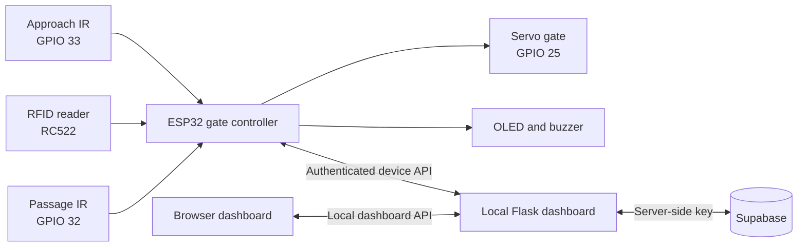

# Parkline — ESP32 Smart Parking Gate

Parkline is a local smart-parking prototype that combines an ESP32-controlled RFID gate with a live Flask dashboard. Drivers tap a registered RFID card to request access; two IR sensors confirm that the vehicle arrived and passed the gate. The dashboard manages users and displays gate state, sensor readings, and timestamped entry and exit records stored in Supabase.

The project is designed for a Windows computer and an ESP32 on the same private 2.4 GHz Wi-Fi network. The dashboard and device API run locally; this repository does not include a public cloud-hosted web service.

## Features

- **Live operations dashboard:** gate state, both IR sensors, controller heartbeat, recent movement, and daily totals.
- **Parking users:** add and search drivers, vehicle plates, and normalized RFID UIDs; duplicate UIDs are rejected.
- **Access history:** review granted and denied card taps, direction, tap time, and IR-confirmed passage time.
- **Automatic gate sequence:** the ESP32 checks card access through the Flask API, drives the servo, shows OLED prompts, and signals events with the buzzer.
- **Supabase storage:** the Flask backend reads and writes parking records with a server-side secret key. The key is not sent to the browser or the ESP32.
- **Windows launcher:** `Start_Smart_Parking.vbs` opens the Parkline Control Center, which prepares Python dependencies, starts the dashboard, checks its health, and opens the page. `run_dashboard.bat` is available for console-based startup.

## How the system works



1. The approach IR sensor detects a waiting vehicle. The OLED asks the driver to tap an RFID card and the buzzer gives a short double beep.
2. The ESP32 sends the card UID to Flask. Flask checks the registered, active user in Supabase and records the tap. Unknown or inactive cards are denied; the gate stays closed.
3. For an approved card, the servo opens the gate, the OLED displays a welcome prompt, and the buzzer gives a confirmation beep.
4. The ESP32 waits for the car to clear the approach sensor and reach the passage sensor. When passage is confirmed, the gate closes and Flask saves the passage timestamp. Supabase updates the driver's inside/outside status from the confirmed direction.
5. The dashboard receives controller sensor and gate state independently from its slower database summary refresh, keeping the live indicator responsive.

The firmware has a 15-second open-gate safety timeout and a 30-second wait limit for a vehicle to begin/complete the expected passage sequence. A timeout closes the gate without recording a completed passage.

## Hardware and pin map

For the full bill of materials, power notes, breadboard guidance, and pin-by-pin wiring reference, see [`docs/hardware-and-wiring.md`](docs/hardware-and-wiring.md).

| Component | Signal | ESP32 connection |
| --- | --- | --- |
| RC522 RFID reader | SDA / SS | GPIO 5 |
|  | SCK | GPIO 18 |
|  | MOSI | GPIO 23 |
|  | MISO | GPIO 19 |
|  | RST | GPIO 22 |
|  | VCC, GND, IRQ | 3.3 V, GND, leave IRQ disconnected |
| Approach IR module | Digital OUT | GPIO 33 |
| Passage IR module | Digital OUT | GPIO 32 |
| Servo | Signal | GPIO 25 |
| OLED display | SDA, SCL | GPIO 21, GPIO 26 |
| Buzzer | Signal | GPIO 27 |

The current firmware expects both IR modules to report detection as `LOW`. It scans for an OLED at I²C address `0x3C` or `0x3D`. Use 3.3 V logic for ESP32 inputs and the RC522. Power the servo from a separate regulated 5 V supply and connect that supply's ground to ESP32 ground; do not power the servo from an ESP32 GPIO. Check the rating and wiring of each module before powering it.

## Project layout

```text
database/                       Supabase tables, indexes, RLS, and status trigger
docs/                           Hardware, wiring, and project reference guides
firmware/ParkingGate/           Integrated ESP32 parking-gate sketch and safe config template
firmware/BuzzerTest/            Standalone buzzer diagnostic sketch
SmartParking_Launcher/          Windows Control Center source
static/                         Dashboard CSS, JavaScript, and browser icon
templates/                      Flask-rendered dashboard page
app.py                          Flask UI/API and server-side Supabase integration
.env.example                    Safe backend configuration template
requirements.txt                Pinned Python dependencies
Start_Smart_Parking.vbs         Quiet Windows launcher entry point
run_dashboard.bat               Console startup fallback
INDEX.md                        File and folder reference
```

## Requirements

- Windows 10 or 11
- Python 3.11 or newer
- Arduino IDE 2 with Espressif ESP32 board support (the sketch is built for ESP32 Arduino core 3.x)
- MFRC522, Adafruit SSD1306, and Adafruit GFX libraries in Arduino IDE; install their listed dependencies through Library Manager when prompted
- An ESP32, RC522 reader and cards, two digital IR modules, servo, I²C OLED, and compatible buzzer
- A 2.4 GHz Wi-Fi network reachable by both the ESP32 and the computer
- A Supabase project with the parking schema described below

## Set up the dashboard

1. Clone this private repository and open its project folder.
2. Copy `.env.example` to `.env`.
3. In `.env`, set `SUPABASE_URL` and the project's server-side `SUPABASE_SECRET_KEY`. Keep this key only on the computer running Flask. Set `FLASK_SECRET_KEY` to a long random local value. For ESP32 access, keep `PARKING_HOST=0.0.0.0` and set a long random `ESP32_API_KEY`.
4. Open `Start_Smart_Parking.vbs` and select **Start dashboard**. On first launch, the Control Center creates the local Python environment and installs the pinned dependencies. The dashboard opens at [http://127.0.0.1:5000](http://127.0.0.1:5000).

For console startup instead, double-click `run_dashboard.bat`. From a configured Python environment, the equivalent command is:

```powershell
python app.py
```

The dashboard can display its setup state without a Supabase key, but adding users and loading live database records require a valid key and the schema. If you change `.env`, restart Flask to apply the change.

## Supabase schema

The app uses two tables:

- `parking_users`: driver name, optional contact details, vehicle plate, unique RFID UID, active flag, and current `INSIDE` / `OUTSIDE` status.
- `parking_events`: card UID, user/vehicle snapshot, `ENTRY` / `EXIT` direction, `GRANTED` / `DENIED` result, card-tap time, and optional confirmed-passage time.

For a fresh Supabase project, review and run [`database/schema.sql`](database/schema.sql) in that project's SQL Editor. It creates the tables, indexes, Row Level Security, service-role permissions, and a trigger that updates a user's current status only after a granted event has a confirmed passage time. For an existing project, compare its schema before applying changes; the app expects the columns defined in the SQL file.

There are no browser-side Supabase credentials. The Flask backend accesses Supabase using the local server-side key, and the ESP32 authenticates its device POST requests using `ESP32_API_KEY`.

## Configure and upload the ESP32 firmware

1. Copy `firmware/ParkingGate/secrets.example.h` to `firmware/ParkingGate/secrets.h`.
2. Set `WIFI_SSID` and `WIFI_PASSWORD` to the 2.4 GHz network shared by the computer and ESP32.
3. Set `SERVER_BASE_URL` to `http://<computer-LAN-IPv4>:5000` (find the computer's LAN IPv4 with `ipconfig`). Do not use `127.0.0.1` here; that address would point the ESP32 back to itself.
4. Set `DEVICE_API_KEY` to exactly the same value as `ESP32_API_KEY` in `.env`.
5. In Arduino IDE, install the libraries **MFRC522**, **Adafruit SSD1306**, and **Adafruit GFX Library**. Select the matching ESP32 board and serial port, then open `firmware/ParkingGate/ParkingGate.ino` and upload it.
6. Start the dashboard and register each card UID under **Parking users**. Use the UID printed by the firmware's Serial Monitor.

`secrets.h` and `.env` contain credentials and are intentionally ignored by Git. Do not commit them or paste their contents into issue reports. If the computer's LAN IP changes, update `SERVER_BASE_URL` and upload the sketch again.

### Allow the ESP32 to reach Flask

The Flask server must bind to `0.0.0.0` for the device to reach it over the local network. Allow Python through Windows Firewall only on the **Private** network profile, and keep the network trusted. The admin dashboard has no login screen and the built-in Flask server is for local development and demonstrations; do not port-forward it, expose it to the public internet, or treat it as production hosting.

## Dashboard updates and device API

The dashboard polls the local Flask process for controller state about every 250 ms, recent access about every second, and database summaries about every five seconds. Access-log and user views use their own slower refresh intervals to avoid reloading large datasets unnecessarily.

The device endpoints used by the sketch are:

| Method and path | Purpose |
| --- | --- |
| `POST /api/device/card-tap` | Authenticate a card, determine direction, and record the tap |
| `POST /api/device/passage` | Save the IR-confirmed vehicle passage |
| `POST /api/device/heartbeat` | Publish gate, phase, sensor, and Wi-Fi readings |
| `GET /api/device/status` | Read the latest local controller status |

Device `POST` endpoints require the configured API key. The browser does not need the device key to display dashboard state.

## Troubleshooting

- **Dashboard says Supabase is not configured:** confirm `.env` exists, the `SUPABASE_URL` and `SUPABASE_SECRET_KEY` are correct, then restart Flask.
- **Dashboard says ESP32 offline:** verify the ESP32 joined the same Wi-Fi, `SERVER_BASE_URL` uses the computer's current LAN IPv4, Flask is running with `PARKING_HOST=0.0.0.0`, the device keys match exactly, and the Private firewall profile permits Python.
- **RFID card is denied:** add the exact UID shown in Serial Monitor to an active parking user. The UID is normalized to uppercase without spaces, colons, or hyphens.
- **IR state looks inverted:** the current sketch treats `LOW` as detected. Check the module output and adjust `IR_DETECTED_LEVEL` in the sketch only if the module's logic is different.
- **OLED is blank:** check power, common ground, SDA on GPIO 21, SCL on GPIO 26, and whether the module responds at `0x3C` or `0x3D`.
- **Servo or board resets:** use an appropriately rated, regulated external 5 V servo supply and connect its ground to ESP32 ground. Keep motor power off the ESP32 3.3 V pin.
- **Upload fails with RFID attached:** disconnect peripherals that interfere with boot/flash pins while uploading, then reconnect after upload. Check Serial Monitor output and avoid wiring loads to boot-strapping pins.

## Project notes

- The dashboard and launcher are Windows-focused; the Flask app itself can run on other Python platforms with suitable configuration.
- This is an educational prototype. Validate the mechanics, power supply, sensors, and gate fail-safe behavior before placing it near a real vehicle or using it for access control.
- The repository is private and currently has no license file. Add a license only after choosing the intended reuse terms.
